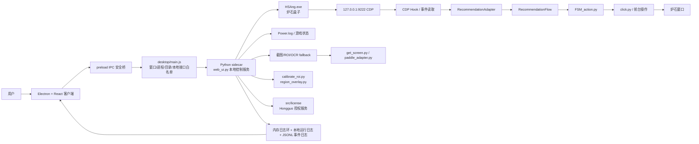

# HSArriver-Turbo AI 开发交接文档

> 这份文档用于把本项目交给下一位 AI/开发者继续开发、修复和打包。它总结的是当前仓库的实际代码、已确认的产品决策和最近会话中的修复结论；如果与源码冲突，以源码和测试为准。

## 0. 接手前先读什么

1. 先读仓库根目录的 `AGENTS.md`，其中包含命令、文件编辑、Git、截图和安全规则。
2. 再读本文件，然后按需要阅读：
   - `docs/PHASE1_EXE_CDP_PLAN.md`：完整第一阶段方案、UI 设计、CDP 字段和授权协议。
   - `docs/HSANG_CEF_DOM_CAPTURE_HANDOFF.md`：炉石盒子 CEF/CDP Hook 的验证和限制。
   - `README.md`、`docs/CLI.md`、`docs/FEATURES.md`：原有引擎能力和命令行使用方式。
3. `web/index.html` 是旧 Web 页面和功能清单的参考资料，不是最终运行时 UI；最终客户端是 Electron + React。
4. `tools/`、`lushibox/`、`lushibox.zip`、文档和截图属于参考资料/测试资料，不能因为“不是当前入口”而删除。

当前仓库：

- Git remote：`https://github.com/LiuHangLiu/HSArriver-Turbo.git`
- 默认分支：`main`
- 最近校准 UI 提交：`91a58ec Restore v11 calibration schematic`
- 目标交付形态：Windows 便携 ZIP，解压后直接运行 EXE，不提供安装向导、不要求打开浏览器。

## 1. 项目用途

HSArriver-Turbo 是一个 Windows 下的炉石传说自动化挂机辅助程序。它负责：

- 启动/监控炉石盒子 `HSAng.exe`、检测 CDP 连接；
- 通过炉石盒子的本机 CDP 读取结构化推荐、动作和 AI 胜率；
- 将推荐转换成现有自动化引擎可以执行的动作；
- 由现有的游戏状态、坐标、点击和 FSM 链路在炉石前台执行操作；
- 提供挂机、投降规则、段位目标、人性化延时、校准、日志与自检；
- 使用与 `D:\workplace\hongguo` 相同的授权/卡密体系，生成设备唯一标识并校验授权租约。

用户期望的使用流程：

1. 解压便携包，必要时右键以管理员身份启动 EXE；
2. 输入卡密并完成授权；
3. 选择炉石盒子目录；
4. 点击“启动盒子”；程序启动 `HSAng.exe --remote-debugging-port=9222 --remote-debugging-address=127.0.0.1`；
5. 确认 CDP 已连接后点击“开始挂机”；
6. 需要校准时，在客户端点击“打开校准窗口”，客户端自动最小化，用户直接在炉石画面上拖动当前目标框，按 `S` 保存、`Esc` 退出、`Tab` 切换目标。

## 2. 核心架构和边界



### 2.1 必须保持的职责边界

| 部分 | 负责什么 | 不负责什么 |
|---|---|---|
| Electron/React | 桌面窗口、菜单、配置表单、状态展示、实时日志和按钮 | 不直接实现游戏策略，不在 React 内复制 Python 业务逻辑 |
| `desktop/main.js` | 创建窗口、启动 Python 引擎、启动盒子、目录选择、IPC 白名单、状态轮询 | 不直接解析推荐 JSON，不直接点击炉石 |
| `web_ui.py` | 本地 HTTP 控制层、状态聚合、日志、授权桥接、自动化生命周期 | 不把 CDP 事件伪装成 OCR 文本 |
| CDP | 读取炉石盒子推荐、AI 胜率和 Hook 状态 | 不负责操作炉石，不替代 `FSM_action.py`/`click.py` |
| `Power.log` | 游戏状态、回合和实体信息的兜底/兼容路径 | 不是盒子推荐的主来源 |
| 截图/OCR | 读取炉石窗口、按钮、选卡组、模式、段位等仍需画面的位置 | 不识别 CDP 推荐和 AI 胜率 |
| 校准层 | 校准真实屏幕上的按钮/ROI 坐标 | 不校准 CDP 推荐和 AI 胜率 |
| `RecommendationFlow`/FSM | 把候选动作校验、时序和执行结果串起来 | 不应被 UI 重写成另一套流程 |

当前原则是“CDP 优先，OCR/截图作为必要的 UI/状态 fallback”。不要为了让代码看起来更短而删除截图：截图仍用于炉石画面定位、按钮存在性、选卡组、模式选择、段位读取和校准验证。

## 3. CDP 推荐链路

### 3.1 连接方式

- 只连接 `127.0.0.1`，默认端口 `9222`；不能绑定公网或局域网。
- Electron 启动盒子时带 `--remote-debugging-port=9222` 和 `--remote-debugging-address=127.0.0.1`。
- `src/cdp/cdp_client.py` 负责 CDP HTTP/WebSocket 连接、target 发现、重连和 Runtime 事件。
- `tools/hsbox_recommend_hook.js` 是参考 Hook；当前 Hook 回调包括：
  - `onUpdateArenaRecommend`
  - `onUpdateLadderActionRecommend`
  - `onUpdateWinrateData`
- `src/cdp/recommendation_reader.py` 读取事件，`src/cdp/recommendation_adapter.py` 将事件转换成统一动作模型，`src/flow/recommendation_flow.py` 再交给现有执行链。

### 3.2 推荐 JSON 处理规则

- 优先读取 Hook 回调 JSON，不直接依赖 DOM 文本。
- 保留完整 `payload`、`raw_args` 和原始事件，不能只抽取一个动作后丢弃原文。
- 未知动作必须记录原始 JSON、暂停或安全重试，不能盲点。
- 正常推荐日志、CDP 原始 JSON、适配后的推荐和最终点击结果必须分开分类。
- 真实样本和字段边界见 `docs/PHASE1_EXE_CDP_PLAN.md` 第 4 节；新增字段先补 adapter 单测，再接入 FSM。

### 3.3 CDP 日志要求

右侧实时日志必须能区分：操作日志、推荐日志、CDP 原始 JSON、Power.log、调试日志。没有连接时应显示类似：

```text
未监听到 CDP 日志：未启动 HSAng.exe，请确认已启动（--remote-debugging-port=9222），并确认只监听 127.0.0.1。
{"schema":1,"kind":"error","error":"connect ECONNREFUSED 127.0.0.1:9222",...}
```

连接并安装 Hook 后，应显示类似真实脚本输出的原始 JSON：

```json
{"schema":1,"kind":"status","status":"hook-installed","captured_at":"...","target":{"id":"...","url":"https://hs-web.lushi.163.com/client-home/","title":"炉石传说盒子"},"result":{"installed":true,"callbacks":["onUpdateArenaRecommend","onUpdateLadderActionRecommend","onUpdateWinrateData"]}}
```

实现位置：`web_ui._cdp_raw_log()`、`web_ui._cdp_error_log()`、`web_ui._start_cdp_log_monitor()`。CDP 高频原始事件使用内存环和独立事件日志，避免把每个事件无限追加到普通运行日志；普通运行日志有大小裁剪逻辑。

状态不能只看“曾经连接过”：盒子退出后，`CDP` 和“盒子状态”都应变为未连接/未运行；炉石状态也要重新按进程和窗口实际情况计算。

## 4. Electron + React 客户端设计

### 4.1 固定布局

客户端是无浏览器地址栏的单窗口桌面应用，默认约 `1680×950`，最小约 `1360×820`：

- 顶部自定义标题栏；
- 左侧固定八项菜单：概览、挂机控制、投降规则、段位目标、人性化、延迟设置、校准、日志与自检；
- 中央内容区；
- 右侧固定实时日志栏；
- 底部固定状态栏。

概览页顶部四张状态卡固定为：授权状态、盒子状态、CDP 状态、炉石状态。未授权状态使用黄色；CDP 已连接必须使用绿色；炉石未运行不能沿用旧的绿色状态。

### 4.2 页面职责

| 页面 | 功能归属 | 精简原则 |
|---|---|---|
| 概览 | 四张状态卡、授权卡密入口、快速控制、设置摘要 | 盒子目录/端口只作为快捷入口，完整编辑归挂机控制；卡密小窗口与授权卡绑定 |
| 挂机控制 | 盒子目录、CDP 端口、启动/停止、挂机运行策略、存活检测和重启策略 | 不要求用户填写炉石 Logs 目录；不重复一套独立配置 store |
| 投降规则 | 自动投降、卡组识别、卡牌搜索、高级 JSON、预览 | 不负责启动盒子或段位目标 |
| 段位目标 | 能力范围内的段位/排名停止条件 | 游戏未启动时当前段位和排名必须为空；不要显示无法读取的伪造默认值 |
| 人性化 | 随机延迟、悬停、低资源、静默和弹窗处理 | 只保留当前引擎真实支持的选项；无后端实现的开关不能假装有效 |
| 延迟设置 | 出牌、推荐等待、换牌、成功/失败等延时 | 使用现有 `config.py`/`/api/delays`，不要让页面本地值与引擎值分叉 |
| 校准 | 只校准截图/点击/段位/选卡组等真实屏幕区域 | CDP 推荐和 AI 胜率不加入校准目标 |
| 日志与自检 | 环境诊断、历史日志、搜索、导出诊断包 | 与右侧“实时日志”分离：右侧是实时流，本页是历史查询和自检 |

### 4.3 当前校准 UI 决策：11 版示意图 + 14 版落地

- 中央预览恢复使用 `desktop/src/assets/calibration-preview.png`，这是 11 版固定示意图，图中展示全部校准框，作为说明图，不在 React 画布内拖框。
- 当前选择的区域只影响右侧坐标参数和真实校准目标，不改变固定示意图上的所有框。
- 点击“打开校准窗口”调用 `POST /api/calibrate`；Python 启动 `calibrate_roi.py` 的透明置顶层，Electron 随后最小化。
- 透明校准层只显示当前目标，其他目标不显示；这样单屏幕时不会被工具窗口遮挡，用户能直接在炉石画面上定位框。
- `GET /api/regions?all=1&meta=1` 只读取区域元数据和坐标，不抓桌面截图；旧的 `/api/regions` 截图能力保留给 Web/诊断兼容路径。
- 当前非 CDP 校准目标共 10 个：换牌确认、结算开始、段位、主菜单、选套牌标题、卡组网格、模式菜单、狂野、标准、休闲。

## 5. 目录和文件说明

### 5.1 根目录核心代码

| 路径 | 作用 | 设计注意 |
|---|---|---|
| `FSM_action.py` | 自动化主流程和动作执行 | 现有核心，不要在 UI 层重写 |
| `click.py` | 鼠标/键盘前台操作和安全检查 | 只对真实炉石窗口操作 |
| `battle_entry.py` | 进入对战、选卡组、模式和开局流程 | 依赖坐标/截图/窗口状态 |
| `battle_record.py` | 对局记录和结构化日志 | 与实时 UI 日志不同 |
| `get_screen.py` | 屏幕截图入口 | CDP 不能完全替代它 |
| `screen_regions.py` | ROI、按钮点、状态点、预览和坐标换算 | 校准和截图识别共用的单一坐标定义 |
| `calibrate_roi.py` | 真实屏幕透明校准层 | 处理拖框、切换目标、保存和恢复 |
| `region_overlay.py` | 浮层/区域可视化 | 不要把校准 UI 再搬回 React 画布 |
| `web_ui.py` | Python 本地控制服务和原 Web 后端 | Electron 通过本地 HTTP 调用；也是授权、日志和自动化编排中心 |
| `config.py` | 默认设置、`ui_config.json` 读写、ROI/延时/运行策略 | 本机路径只写运行时配置，不写 Git 模板 |
| `selfcheck.py` | 环境自检 | OCR/PaddleOCR 是可选 fallback，CDP 主链路不应被其阻断 |
| `power_log.py` / `log_state.py` | Power.log 读取和游戏状态解析 | 作为状态兜底，不是推荐来源 |
| `strategy.py` / `strategy_entity.py` | 策略和实体模型 | 推荐适配完成后仍由现有流程使用 |
| `surrender_rules.py` | 投降规则编译和预览 | 页面保存通过 `/api/surrender_rules` |
| `hs_restart.py` / `window_tracker.py` | 炉石重启和窗口监测 | 与挂机控制/存活检测相关 |
| `script_logs.py` / `feedback.py` | 日志统计、清理和问题反馈包 | 不要把炉石用户 Logs 目录当作脚本日志目录删除 |
| `main.py` / `hsctl.py` | 旧命令行入口和控制工具 | 继续保留用于诊断、兼容和回归测试 |
| `native_console.py` / `qt_console.py` / `phase1_launcher.py` | 历史/兼容入口 | Electron 是最终 UI，但这些源文件是参考和兼容代码，不能随意删除 |

### 5.2 `src/` 模块

| 目录 | 设计思想 |
|---|---|
| `src/cdp/` | CDP 客户端、盒子事件、推荐读取和统一动作适配；保留 raw event |
| `src/flow/` | 推荐执行时序、手牌动画延时、投降流程；尽量不与 UI 耦合 |
| `src/game_state/` | 发现、选择目标、星舰等游戏状态模型 |
| `src/license/` | 设备指纹、卡密激活、挑战签名、租约刷新和状态读取；复用 Hongguo 协议 |
| `src/ocr/` | PaddleOCR 适配、预处理和稳定读取；仅为 fallback |
| `src/parser/` | 旧推荐解析器；CDP 正常路径应优先走 `src/cdp/` |
| `src/safety/` | 炉石存活、安全校验和重启 watchdog |
| `src/recommendation_config.py` / `src/recommendation_models.py` | 推荐来源配置和动作模型 |

### 5.3 `desktop/` Electron 工程

| 路径 | 作用 |
|---|---|
| `desktop/main.js` | Electron 主进程；启动窗口、sidecar、盒子，维护 IPC 白名单和状态 |
| `desktop/preload.js` | 只暴露必要的 `window.control`、`engine`、`runtime` API；React 不直接使用 Node |
| `desktop/src/main.jsx` | React 页面、状态轮询、页面布局和调用后端 API |
| `desktop/src/styles.css` | 目标 UI 的深色布局、颜色、字体、状态色和八页样式 |
| `desktop/src/contract.mjs` | 菜单、日志筛选和前端契约常量 |
| `desktop/src/assets/` | 客户端静态资源；`calibration-preview.png` 是 11 版校准示意图，排名徽章等用于 UI |
| `desktop/index.html` | Vite/Electron 前端入口 |
| `desktop/vite.config.mjs` | React 构建配置 |
| `desktop/scripts/make-zip.cjs` | 将 `win-unpacked` 便携目录压缩为 ZIP |
| `desktop/test/ui.test.mjs` | Electron/React 契约和日志分类单元测试 |
| `desktop/package.json` | `dev`、`build:react`、`build:dir`、`build:zip`、`test` 脚本 |

### 5.4 参考资料和不能删除的内容

- `docs/`：技术方案、协议交接、命令说明、功能说明、旧 Web 参考截图和 UI 设计图。
- `web/index.html`：旧 Web 页面，运行时不再作为客户端界面，但用于逐项核对功能覆盖。
- `tools/`：CDP Hook、监听器、只读观察器、构建/发布辅助工具；`tools/lushihook.zip` 也保留。
- `assets/`：旧 OCR/界面模板。
- `lushibox/`、`lushibox.zip`、`mermaid-diagram.png`：用户提供的参考项目/资料，不删除。
- `cards.json`：核心卡牌数据，必须随仓库发布。

## 6. 主要本地 API

Electron 只通过 `desktop/main.js` 的 `ALLOWED_PATHS` 访问本地 Python 服务，React 不直接拼接任意本地请求。主要接口：

| 方法 | 路径 | 用途 |
|---|---|---|
| GET | `/api/status` | 汇总引擎、盒子、CDP、炉石、挂机、统计状态 |
| GET/POST | `/api/config` | 读取/保存本机配置 |
| GET | `/api/license/status` | 读取设备和授权租约状态 |
| POST | `/api/license/activate` | 使用卡密激活设备 |
| GET | `/api/logs?seq=N` | 拉取增量实时日志 |
| GET/POST | `/api/selfcheck` | 环境自检 |
| GET | `/api/regions?all=1&meta=1` | 读取校准区域元数据，不截图 |
| POST | `/api/calibrate` | 启动/切换真实屏幕校准层 |
| POST | `/api/start` / `/api/prepare` | 启动挂机或准备进入对战 |
| POST | `/api/stop` / `/api/cancel` | 停止挂机/取消流程 |
| POST | `/api/surrender_rules` | 保存投降规则 |
| POST | `/api/rank_stop` | 保存段位目标 |
| POST | `/api/human_like` | 保存人性化设置 |
| POST | `/api/delays` | 保存延时设置 |
| POST | `/api/restart_hearthstone` | 炉石重启/恢复 |
| POST | `/api/feedback/export` | 导出诊断反馈包 |

授权服务继续复用 `D:\workplace\hongguo` 的现有协议；当前方案文档记录的服务域名是 `https://api.hgapp.shop`。客户端只做挑战、卡密激活、租约刷新和验签，不保存服务端私钥，不自行生成“试用一天”，试用也必须由服务端发放试用卡密。

## 7. 配置、日志和状态设计

- 本机配置写入运行时 `ui_config.json`，不能把真实用户路径、卡密、设备标识或 token 写入 Git。
- `recommendation.source` 固定优先使用 `cdp`，`host` 固定 `127.0.0.1`，默认 `port` 为 `9222`。
- 实时日志使用带序号的内存环，Electron 通过 `/api/logs?seq=N` 增量拉取；勾选过滤只影响显示，不应丢失原始事件。
- 普通运行日志会落盘并裁剪；CDP 高频 raw event 使用 `persist=False` 的内存实时通道，完整事件另走 JSONL journal，避免普通日志无限膨胀。
- 退出盒子、CDP 断开、炉石退出都必须触发状态重新计算；不能继续显示旧的“已连接/运行中”。
- 前端“日志与自检”查看历史文件，右侧日志只显示当前实时流；两个视图不能混成同一个数组或互相覆盖。

## 8. 开发、测试和打包

在仓库根目录执行 Python 测试前，按项目环境使用可用解释器；Electron 脚本在 `desktop/` 目录执行：

```powershell
cd D:\workplace\HSArriver-Turbo\desktop
npm test
npm run build:react
npm run build:dir
npm run build:zip
```

Python 侧建议至少运行：

```powershell
python -m py_compile web_ui.py screen_regions.py calibrate_roi.py desktop_engine.py
python -m pytest -q
```

构建链路：

1. `tools/build_electron_engine.py` 或已有构建脚本生成 Python sidecar；
2. Electron Builder 将 React 静态文件放入 `app.asar`；
3. `extraResources` 将 Python 源码、模板、卡牌数据和 sidecar 放到 `resources/engine`；
4. `make-zip.cjs` 压缩 `win-unpacked`，最终交付 ZIP，不提交 ZIP、`dist/` 或 `build/`。

验收重点：

- 盒子目录保存后再次打开仍存在；
- 启动盒子实际带 CDP 参数，EACCES 时能通过 PowerShell fallback 启动；
- CDP 未启动时右侧显示明确的未监听提示；连接后能显示 `hook-installed` 原始 JSON；
- 盒子退出后盒子/CDP 状态变为未运行/未连接；
- 概览未授权使用黄色，CDP 连接使用绿色；
- 游戏未启动时段位当前值和排名为空；
- 校准只对非 CDP 的 10 个真实屏幕目标生效，CDP 推荐/胜率不出现在校准目标中；
- 单屏幕校准时 Electron 会最小化，用户能看到炉石并拖动当前框；
- 右侧日志可独立勾选操作、推荐、CDP 原始 JSON、Power.log、调试五类；
- 便携包解压后不依赖 `5173` 浏览器页面。

## 9. 后续 AI 修复时的工作顺序

1. `git status --short`，确认不要碰用户提供的参考资料和未跟踪素材。
2. 先复现并读相关测试，再查 `/api/status`、`/api/logs` 和 Python 引擎日志，不要先改 UI 猜测。
3. 修复后补最小单元测试：CDP 解析/日志分类/状态计算/校准目标优先于截图肉眼判断。
4. UI 修改只改 `desktop/src/`，业务行为改 Python API 或核心模块；不要把业务逻辑复制到 React。
5. 提交前运行 `git diff --check`、`desktop/npm test`、相关 Python 测试和必要的构建检查。
6. 未经用户明确要求不要 `git push`；不要把本机路径、授权 token、卡密、日志、编译目录和便携包提交到 Git。

## 10. 当前已知风险

- HSAng 版本变化可能导致 CDP target、Hook 回调或推荐字段变化；遇到未知字段先保存原始事件，再补适配和回归测试。
- CDP 端口能连通不等于推荐页面 Hook 已安装；状态 UI 应区分端口连接和 Hook/推荐可用性。
- 炉石窗口尺寸、DPI、缩放和窗口模式会影响坐标；校准必须在实际运行机器和实际窗口尺寸下执行。
- 便携版中的 OCR/Paddle 依赖体积较大，但它是 fallback；不能因为 OCR 自检警告阻断 CDP 主链路。
- 不要把 `web/index.html` 重新当成最终 UI；它只用于检查功能是否 100% 覆盖和参考旧交互。

